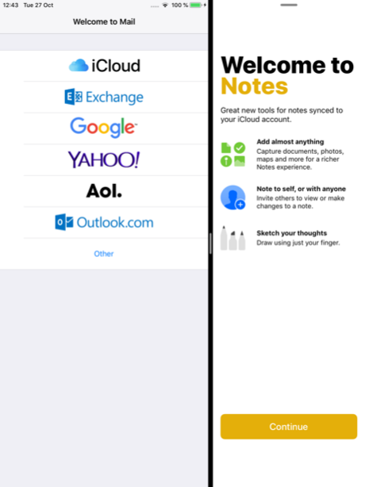
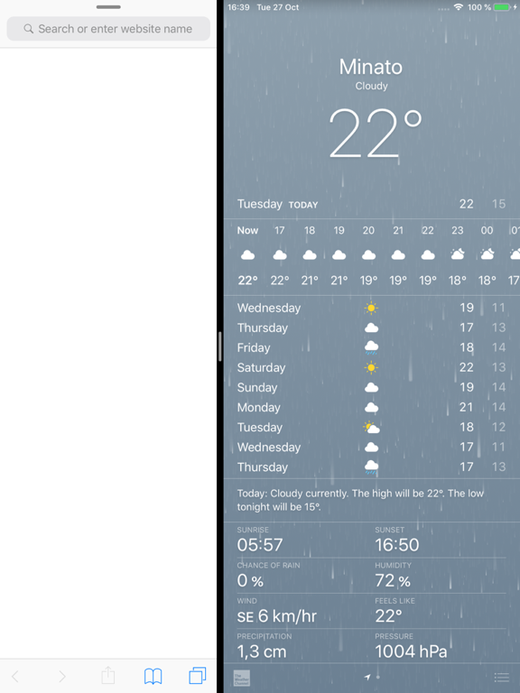
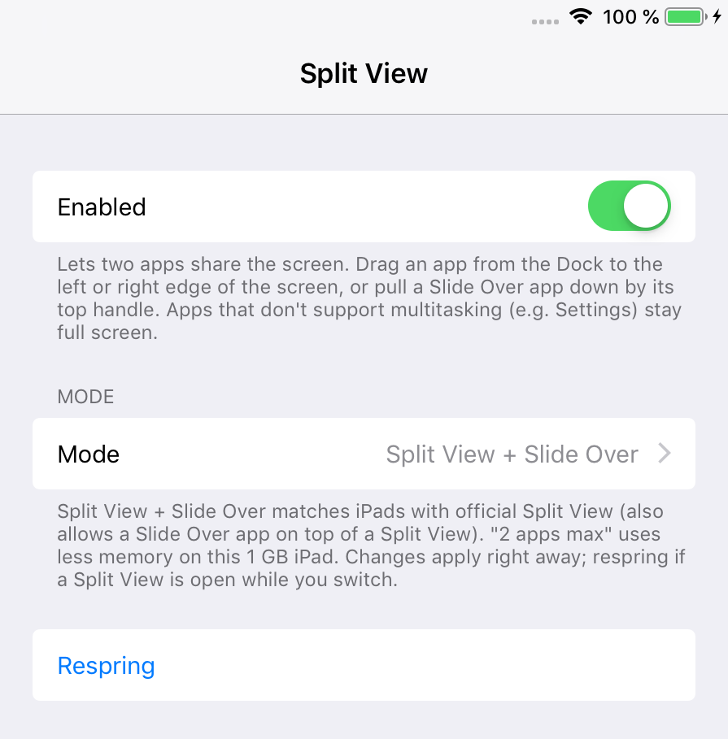

# SplitViewEnabler (iOS 12)

**Split View and Slide Over on iPads that only had Slide Over.**

Apple left Split View out on some iPads that run iOS 12, such as the iPad mini 2, iPad mini 3 and the first iPad Air. They only get Slide Over, so you can never have two apps side by side.

SplitViewEnabler turns on real Split View on these iPads. Two apps can share the screen, and you can even put a third app in Slide Over on top of them, just like on newer iPads.

To use it, drag an app from the Dock to the left or right edge of the screen, or pull a Slide Over app down by its top handle. Apps that don't support multitasking (such as Settings) stay full screen.

This is an unofficial jailbreak tweak. It is not affiliated with or endorsed by Apple.

## Screenshots

| Mail and Notes | Safari and Weather |
| --- | --- |
|  |  |

Settings > Split View:



## Features

- Split View: two apps side by side, in portrait and landscape.
- Slide Over on top of a Split View (three apps at once).
- A lighter "2 apps max" mode for iPads with 1 GB of memory.
- On/off switch and mode picker in Settings. Changes apply right away, no respring needed.

## Compatibility

- Tested on an iPad mini 2 with iOS 12.5.8, jailbroken with checkra1n + odysseyra1n (libhooker).
- Expected to work on iOS 12.x.
- Made for 64-bit iPads that have Slide Over but no Split View: iPad mini 2, iPad mini 3 and iPad Air (1st generation).
- iPads that already have full Split View are not changed. The tweak only ever raises what an iPad can do, never lowers it.

## Install

Add the **iOS Legacy** source to your package manager, then search for SplitViewEnabler:

```
https://itsallexb.github.io/ios-legacy/
```

One tap on your device: [Add to Sileo](https://itsallexb.github.io/ios-legacy/add/sileo.html) · [Add to Zebra](https://itsallexb.github.io/ios-legacy/add/zebra.html) · [Add to Cydia](https://itsallexb.github.io/ios-legacy/add/cydia.html)

Or download the `.deb` from [Releases](https://github.com/itsAllexB/SplitViewEnabler-iOS12/releases/latest) and install it with Filza or `dpkg -i`, then respring.

Requires `mobilesubstrate` (Substrate, Substitute or libhooker) and PreferenceLoader. Your package manager installs them automatically.

## Settings

Open **Settings > Split View**:

- **Enabled**: turns the tweak on or off.
- **Mode**:
  - *Split View + Slide Over* (default): like iPads with official Split View, including a Slide Over app on top of a Split View.
  - *Split View, 2 apps max*: Split View without the extra Slide Over app. Uses less memory.
  - *Slide Over only (stock)*: Apple's original behaviour.
- **Respring**: restarts SpringBoard (no reboot). Only needed if a Split View is open while you switch modes.

## Build from source

You need [Theos](https://theos.dev/docs/installation) and an iOS SDK (the Makefile uses the iOS 14.5 SDK and targets iOS 12.0, arm64).

```sh
git clone https://github.com/itsAllexB/SplitViewEnabler-iOS12.git
cd SplitViewEnabler-iOS12
make package FINALPACKAGE=1
```

The package is written to `packages/`. To install it on a device over SSH, set `THEOS_DEVICE_IP` and run `make install`.

How it works: on iOS 12, SpringBoard decides what kind of multitasking an iPad gets in `-[SBPlatformController medusaCapabilities]` (1 = Slide Over, 2 = Split View, 3 = Split View with Slide Over on top). The tweak raises that value to the mode you pick, on iPads that support at least Slide Over. Per-app rules are untouched, so apps without multitasking support stay full screen. See the comments in [`Tweak.x`](Tweak.x).

## Credits and license

Made by [itsAllexB](https://github.com/itsAllexB).

SplitViewEnabler is free software under the GNU General Public License v3.0 or later. See [LICENSE](LICENSE).

iPad, Split View and Slide Over are trademarks of Apple Inc. This project is not affiliated with Apple.
